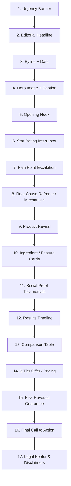

# The E-Commerce AI Advertorial Playbook
### High-Converting Direct Response Presell Pages via Claude Code & Google Antigravity
*Based on the methodology by Mike Futia (SCALE AI), adapted for automated agentic workflows.*

---

## 1. Executive Summary & Core Philosophy

### What is an Advertorial?
An **advertorial** is a hybrid presell landing page designed to bridge cold ad traffic (Meta, TikTok, Native, YouTube) to a Direct-to-Consumer (DTC) offer. Unlike a direct product page (PDP) that demands an immediate purchase decision, an advertorial disguises itself as an authoritative article, investigative report, or lifestyle feature.

### The Core Law of Advertorials
> **"You are not building a landing page. You are writing a magazine article that happens to sell a product. The reader should be 80% through the page before they realize they are being sold to. Every paragraph earns the next scroll."**

### Why Use Agentic AI (Claude Code / Antigravity)?
* **Traditional bottleneck**: Writing and designing a custom advertorial takes days, requiring senior DR copywriters, UI designers, and frontend devs.
* **The "One-Shot" AI Advantage**: With a strictly engineered system prompt (`CLAUDE.md`), an AI agent can ingest 6 key product inputs, generate all necessary images via API, and output a complete, responsive, self-contained single-file HTML advertorial in under 3 minutes.
* **Scaling velocity**: Allows e-commerce brands and performance agencies to test 5–10 unique advertorial angles per week per product.

---

## 2. Environment Setup & Tooling Comparison

| Platform | Best For | Pros | Cons / Notes |
| :--- | :--- | :--- | :--- |
| **Google Antigravity IDE** *(Recommended for speed)* | Marketers & devs seeking lightning-fast generation | Noticeably snappier build times; native browser previewing; integrated command execution. | Requires IDE workspace setup. |
| **Claude Desktop App (Mac)** | Non-technical operators & beginners | Simple UI; uses familiar desktop chat tab; built-in local preview toggle. | Slower generation speed than IDE environments. |
| **Cursor / VS Code** | Developers with existing custom workflows | Full terminal and git integration. | Requires command-line comfort. |

### Image Generation API Setup
* **Engine**: Nano Banana Pro API (`fal-ai/nano-banana-pro`) or Google Gemini Image Generation.
* **Prerequisite**: An API Key (Google AI Studio / FAL).
* **Pro-Tip from Video**: Always feed the exact API documentation as markdown directly into the chat session. Never let the agent blindly search the web for API specs, which risks hallucinating outdated models or endpoints.

---

## 3. The 6-Question Intake Engine

When launching a new advertorial build, the system prompt restricts the AI to asking exactly six structured questions all at once:

```text
1. "What's the brand name, product name, and price?"
   Example: "GlowRevive, Vitamin C Brightening Serum, $49"

2. "Who's the target customer?" (Demographics + specific pain points)
   Example: "Women 28-45, dark spots, uneven skin tone, dull complexion"

3. "What's the mechanism / unique angle?" (The "why this works when others fail" logic)
   Example: "Lipid-encapsulated vitamin C that stays stable until it reaches the dermal layer"

4. "What proof do you have?" (Metrics, credentials, testimonials, media)
   Example: "47,000+ reviews, 4.8 stars, dermatologist-formulated, featured in Allure"

5. "Pick a page style" (Select Preset A, B, C, or D)
   Example: "Preset A — Clinical Editorial"

6. "Do you have product image URLs?" (Optional)
   Example: "No, generate them using Nano Banana Pro API"
```

---

## 4. The 4 Proven Aesthetic & Psychological Presets

The core 17-section direct response structure never changes; only the visual styling and narrative voice adapt to match product niche expectations.

```
       ┌────────────────────────────────────────────────────────┐
       │               PAGE STYLE PRESETS SELECTION             │
       └────────────────────────────────────────────────────────┘
          │                  │                  │             │
          ▼                  ▼                  ▼             ▼
  ┌───────────────┐  ┌───────────────┐  ┌──────────────┐  ┌───────────────┐
  │   Preset A:   │  │   Preset B:   │  │  Preset C:   │  │   Preset D:   │
  │   Clinical    │  │   Lifestyle   │  │ News Exposé  │  │    Warm &     │
  │   Editorial   │  │   Magazine    │  │              │  │  Trustworthy  │
  ├───────────────┤  ├───────────────┤  ├──────────────┤  ├───────────────┤
  │ Skincare,     │  │ Beauty, Home, │  │ Supplements, │  │ Pet products, │
  │ Supplements,  │  │ Premium DTC,  │  │ Diet, Secret │  │ Parenting,    │
  │ Health        │  │ Fashion       │  │ Disruption   │  │ Family/Cozy   │
  └───────────────┘  └───────────────┘  └──────────────┘  └───────────────┘
```

### Detailed Preset Specifications

#### Preset A — "Clinical Editorial" (Default)
* **Identity**: Authoritative medical journal or clinical dermatological report.
* **Palette**: `#FFFFFF` (White background), `#1A1A1A` (Charcoal body), `#2B6CB0` (Medical blue accents), `#F7FAFC` (Light gray cards).
* **Typography**: Serif headlines (Georgia/Playfair), clean sans-serif body. Max-width: `720px`.
* **Persona**: Board-certified physician, dermatologist, or formulation specialist.
* **Best For**: Skincare, anti-aging, clinical wellness, joint relief.

#### Preset B — "Lifestyle Magazine"
* **Identity**: Editorial feature reminiscent of *Cosmopolitan*, *Vogue*, or *GQ*.
* **Palette**: `#FEFCFB` (Off-white), `#2D3748` (Dark slate text), `#C53030` (Warm rose) or `#D69E2E` (Gold accents), `#FFFAF0` (Cream alternate rows).
* **Typography**: Elegant modern serif display headers, clean minimal body. Max-width: `760px`.
* **Persona**: Beauty editor, lifestyle columnist, or "our team tested it for 30 days" editorial staff.
* **Best For**: Luxury cosmetics, fragrance, haircare, boutique lifestyle items.

#### Preset C — "News Exposé"
* **Identity**: Viral investigative piece or whistleblower consumer protection bulletin.
* **Palette**: `#FFFFFF` (Stark white), `#111111` (Deep black), `#E53E3E` (Alert red accents), `#F6E05E` (Yellow highlighter callouts).
* **Typography**: High-impact bold sans-serif headlines, tight scannable paragraphs. Max-width: `700px`.
* **Persona**: Consumer advocate, investigative reporter, or ex-industry insider.
* **Best For**: Gut health, big-pharma alternatives, weight loss, anti-scam positioning.

#### Preset D — "Warm & Trustworthy"
* **Identity**: Cozy, relatable peer-to-peer recommendation over coffee or in a parenting group.
* **Palette**: `#FFFDF7` (Warm cream), `#3D2C1E` (Warm brown text), `#276749` (Forest green accents), `#F5EDDF` (Soft tan backgrounds).
* **Typography**: Soft rounded sans-serif headlines, friendly readable copy. Max-width: `700px`.
* **Persona**: Relatable parent, dedicated pet owner, or active community member.
* **Best For**: Dog/cat supplements, baby gear, kitchenware, garden & craft.

---

## 5. The 17-Section Conversion Architecture

The section order is mathematically engineered for scroll retention and psychological persuasion. **Do not reorder these sections.**



---

### Step-by-Step Breakdown of Every Section

#### 1. Urgency Banner
* **Goal**: Establish immediate context and scarcity before the headline is read.
* **Visual**: Sticky or top-anchored slim banner with contrasting accent color.
* **Formulas**:
  * `"BREAKING: New clinical findings reveal why standard [category] fail..."`
  * `"SPECIAL REPORT: 47,000+ women switched to this morning routine in September"`

#### 2. Editorial Headline
* **Goal**: Maximize curiosity and borrow authority. Must read like journalism, never an ad.
* **Winning Patterns**:
  * `[Number] [Target Audience] Are [Taking Specific Action] To [Get Result] — [Authority] Explains Why`
  * *Example*: *"The $49 Vitamin C Serum Dermatologists Are Quietly Recommending to Their Own Patients"*
  * *Example*: *"The $9 Billion Probiotic Industry Has a Dirty Secret — And 180,000 People Already Found the Fix"*
  * *Example*: *"The Vet-Recommended Joint Chew Giving Senior Dogs Their Zoomies Back"*

#### 3. Byline + Credibility Timestamp
* **Goal**: Cement instant editorial legitimacy.
* **Format**: `"By [Name], [Credential/Title] | Published [Date 2–3 days ago] | Medically Reviewed by [Name]"`

#### 4. Hero Lifestyle Image + Editorial Caption
* **Goal**: Visual hook anchoring the emotional desire or problem state.
* **Specs**: Full container width, 8px rounded corners, subtle shadow.
* **Crucial Detail**: Always include an editorial italic caption beneath (e.g., *"Figure 1.1: Why 85% of topical serums oxidize before penetrating the epidermis"*).

#### 5. Opening Hook (2–3 Paragraphs)
* **Goal**: Induce the reader's self-identification nod ("That's me!").
* **Technique**: Use second-person perspective (`"If you have ever..."`). Describe the exact physical sensory feeling of the problem. Tease the solution without naming the brand.

#### 6. Star Rating Interrupter
* **Goal**: Micro-conversion commitment. Break the reading flow with undeniable aggregate proof.
* **Format**: `★★★★★ 4.8/5 Star Rating from 47,382 Verified Customers`.

#### 7. Pain Point Escalation
* **Goal**: Take the initial symptom and expose the deeper cascading danger if ignored.
* **Structure**: Checkmark bullet list of agonizing everyday micro-frustrations.
* **Copy Trigger**: `"Sound familiar? You're not alone. In fact, research shows..."`

#### 8. Root Cause Reframe (The Mechanism Hero)
* **Goal**: The most critical inflection point of the page. Expose why all previous solutions failed.
* **Core Logic**:
  1. It's not your fault.
  2. Traditional products only address surface symptoms (or use degraded delivery systems).
  3. The real villain is [biological/physical barrier].
  4. Only a solution that solves [biological/physical barrier] can actually work.

#### 9. Product Reveal & Origin Story
* **Goal**: Introduce the brand not as a commercial product, but as the inevitable breakthrough answer to the root cause.
* **Content**: Product shot, origin story (years in R&D, clinical trial rounds), 3–4 bullet differentiators.

#### 10. Ingredient / Feature Deep-Dive Cards
* **Goal**: Rational justification for the emotional purchase decision.
* **Layout**: 3–4 cards in a 2-column or stacked grid.
* **Card Recipe**: Icon/Visual + Clinically Verified Ingredient + Plain English Mechanism + Exact Percentage Metric (`"shown to increase skin elasticity by 42% in 21 days"`).

#### 11. Narrative Social Proof Block
* **Goal**: Preempt and dismantle objections via storytelling.
* **Structure**: 3–4 cards with avatar, star rating, verified buyer badge, location/age.
* **Mandatory Element**: At least one testimonial must showcase deep initial skepticism turning into overwhelming satisfaction.

#### 12. Results Timeline (Expectation Setter)
* **Goal**: Paint vivid mental movies of the customer's near future.
* **Phases**:
  * *Days 1–7*: Immediate sensory relief or ritual adoption.
  * *Days 14–21*: Measurable initial transformations; family/friends start noticing.
  * *Days 30–60*: Complete structural transformation and permanent habits.

#### 13. Comparison Table ("Us vs. The Rest")
* **Goal**: Make choosing any alternative feel mathematically irrational.
* **Layout**: 2-column matrix comparing `Your Product` vs. `Typical Generic Alternatives`.
* **Criteria**: Bioavailability, clinical purity, third-party testing, price per day, risk-free trial. Your product wins every row.

#### 14. 3-Tier Offer & Pricing Packages
* **Goal**: Maximize Average Order Value (AOV).
* **Hierarchy**:
  1. *Tier 1*: 1 Bottle / Starter Pack (Standard price, paid shipping).
  2. *Tier 2*: 3 Bottles / Bundle (**"MOST POPULAR"** / Highlighted border, free shipping, 20% discount).
  3. *Tier 3*: 6 Bottles / Mega Bundle (**"BEST VALUE"**, highest volume savings, free bonus gifts).

#### 15. The "No-Questions-Asked" Guarantee
* **Goal**: Completely eradicate perceived buyer risk.
* **Copy**: 60-Day or 90-Day 100% Money-Back Guarantee. `"Even if you return the empty bottle, you get every penny back."` Include a trust badge or shield.

#### 16. Final Scarcity Call to Action (CTA)
* **Goal**: Force the immediate click before leaving the page.
* **Triggers**: Limited batch supply notice, seasonal price lock countdown, high-contrast button with minimum 48px tap height.

#### 17. Compliant Editorial Footer
* **Goal**: Satisfy ad network compliance (Meta/Google/TikTok policy).
* **Components**: FDA/FTC disclaimer, dietary supplement disclaimer, terms of service, privacy policy, contact address.

---

## 6. The "Anti-AI Slop" Copywriting Standard

AI copywriters often sound synthetic. The system prompt enforces strict direct-response guardrails:

### 🚫 The Banned Vocabulary List
Never allow the agent to use these hallmark AI buzzwords:
```
delve • landscape • testament • showcase • foster • underscore 
pivotal • crucial • realm • myriad • tapestry • multifaceted 
commendable • intricate • comprehensive • game-changer • revolutionize
```

### ✅ The Direct Response Transformation Rules
* **Journalistic Tone over Marketing Hype**: Never say *"This revolutionary serum will change your life!"* Write: *"Dermatologists at the Zurich Skin Institute were puzzled by why 92% of topical serums oxidized within 10 minutes of exposure to air."*
* **Radical Specificity**:
  * ❌ *"Helped thousands of happy women."*
  * ✅ *"Tested across 4,812 women ages 34 to 62."*
  * ❌ *"Visible results fast."*
  * ✅ *"A measurable 27% reduction in pigmentation depth by Day 19."*
  * ❌ *"Affordable everyday price."*
  * ✅ *"Costs $1.63 per day — less than half a cup of coffee."*
* **Human Testimonial Cadence**: Realistic reviews contain friction, doubt, and candid vocabulary:
  > *"I honestly thought this was another TikTok gimmick. I've bought at least 5 different serums from Sephora that did absolutely nothing. But my sister wouldn't stop bugging me about it. Took about 12 days before my husband asked what I was doing differently with my skin. Just ordered the 3-pack."*

---

## 7. Visual Generation Prompt Engineering (Nano Banana Pro / Gemini)

When real product photography is unavailable, prompt the image generation engine using these four strict templates:

```markdown
1. Hero Lifestyle Image:
   "[Target demo, e.g. woman in late 30s with glowing natural skin] applying serum drops to her cheek, warm morning bathroom lighting, soft focus background, editorial beauty photography, clean aesthetic, high resolution, no text"

2. Product Showcase Shot:
   "Professional studio product photography of a premium minimalist amber glass dropper bottle on a smooth travertine stone podium, soft clinical morning light, editorial luxury packaging, high resolution, clean background, 8k, no text"

3. Ingredient / Mechanism Visual:
   "Macro scientific photography of lipid micro-capsules encapsulating pure golden vitamin C spheres, clean lab aesthetic, soft blue and white lighting, depth of field, medical editorial style, no text"

4. Before / After Transformation:
   "Close-up realistic portrait photography showing subtle skin tone refinement, side-by-side progression style, authentic texture, natural daylight, zero heavy makeup, documentary editorial style, no text"
```

> **⚠️ Critical Image Bug Fix**: In AI-generated product packaging, models often leave brand labels blank or distorted. **Rule**: Prompt the model for *"clean minimalist unlabeled amber bottle with dropper"* and overlay the brand title via pure CSS/HTML text over the visual container, or supply authentic product PNGs.

---

## 8. Technical Architecture & CMS Deployment

### Single-File Standalone Architecture
The output must strictly be a **single, zero-dependency `index.html` file**:
* **CSS**: Embedded entirely in a single `<style>` block in `<head>`.
* **Typography**: Self-contained `<link>` imports for 1 Serif (e.g., `Newsreader` or `Playfair Display`) and 1 Sans-Serif (e.g., `Inter` or `Plus Jakarta Sans`).
* **Icons / Stars**: Inline SVG or native Unicode entities (`★ ★ ★ ★ ★`). Zero FontAwesome/external script dependencies.
* **JavaScript**: Zero JS required. Prevents conflicts with tracking pixels, tag managers, and CMS loaders.
* **Mobile-First Width**: Constrained reading column (`max-width: 720px; margin: 0 auto; padding: 0 16px;`).

### How to Deploy Into E-Commerce Platforms
1. **Shopify**: Create a new Page template (`page.advertorial.liquid`) without standard theme headers/footers, and paste the raw HTML inside.
2. **Webflow / WordPress / ClickFunnels**: Drop a single "Custom Code / Embed" block on a blank page and paste the entire `index.html`.
3. **Headless / Vercel**: Drop `index.html` into a GitHub repository connected to Cloudflare Pages or Vercel for instant static hosting.

---

## 9. Marketer's Step-by-Step SOP

```
   ┌──────────────────────────────────────────────────────────────┐
   │                  THE ADVERTORIAL CREATION SOP                │
   └──────────────────────────────────────────────────────────────┘
                                  │
                                  ▼
   ┌──────────────────────────────────────────────────────────────┐
   │  Step 1: Setup Workspace & Configuration                     │
   │  • Ensure `CLAUDE.md` is in project root                     │
   │  • Have Gemini API Key / Nano Banana credentials handy       │
   └──────────────────────────────────────────────────────────────┘
                                  │
                                  ▼
   ┌──────────────────────────────────────────────────────────────┐
   │  Step 2: Initialize Session & Feed API Docs                  │
   │  • Run: "Help me build a new advertorial page"               │
   │  • Feed one-click markdown docs for image API                │
   └──────────────────────────────────────────────────────────────┘
                                  │
                                  ▼
   ┌──────────────────────────────────────────────────────────────┐
   │  Step 3: Answer the 6 Core Questions                         │
   │  • Brand, Customer, Mechanism, Proof, Preset, Images         │
   └──────────────────────────────────────────────────────────────┘
                                  │
                                  ▼
   ┌──────────────────────────────────────────────────────────────┐
   │  Step 4: Autonomous Build Execution                          │
   │  • Agent writes 17 sections with anti-AI rules               │
   │  • Agent generates/links images                              │
   │  • Agent compiles responsive `index.html`                    │
   └──────────────────────────────────────────────────────────────┘
                                  │
                                  ▼
   ┌──────────────────────────────────────────────────────────────┐
   │  Step 5: Visual Verification & Media Buying Hook             │
   │  • Toggle local preview / review screenshots                 │
   │  • Match Meta Ad Creative headline to Advertorial Section 2  │
   │  • Deploy single file to production                          │
   └──────────────────────────────────────────────────────────────┘
```

### Media Buying Synchronization Rule
For optimal Click-Through-to-Purchase conversion:
* **The Ad Hook**: The first 3 seconds of your Meta video ad or the primary image headline must directly echo **Section 2 (Editorial Headline)** of the advertorial.
* **Congruence**: If the ad says *"Dermatologists are ditching traditional vitamin C"*, the advertorial headline must open with *"The $49 Vitamin C Serum Dermatologists Are Quietly Recommending to Their Own Patients"*. This seamless scent-trail eliminates drop-off.
