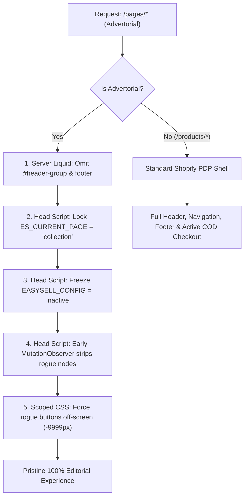

# 🚀 DTC Advertorial Shopify Engine & Isolation Architecture

[](https://shopify.dev)
[](docs/SHOPIFY_ADVERTORIAL_ISOLATION_PLAYBOOK.md)
[](docs/CASE_STUDY_POSTMORTEM.md)
[](LICENSE)

An enterprise-grade, battle-tested framework and automation toolkit for deploying high-converting, isolated **Direct-Response Advertorial Presell Pages** on Shopify OS 2.0 without theme header/footer noise or third-party app widget bleed.

---

## 🎯 The Core Mission

> **"You are not building a landing page. You are writing an authoritative magazine article that happens to sell a product. The reader must be 80% through the narrative before they realize they are being sold to. Every paragraph earns the next scroll."**

Standard Shopify themes automatically inject global headers, navigation drawers, store footers, and third-party app embeds (like Cash-On-Delivery buttons or chat popups) onto every page. This engine completely isolates the advertorial, maintaining strict editorial credibility while keeping normal e-commerce functionality intact on Product Detail Pages (PDP).

---

## 📁 Repository Structure

```text
├── docs/
│   ├── CASE_STUDY_POSTMORTEM.md              # Complete breakdown of failures, traps & the winning architecture
│   ├── SHOPIFY_ADVERTORIAL_ISOLATION_PLAYBOOK.md # 10 approaches ranked with criteria, scoring & diagrams
│   └── HUMAN_OPERATING_MANUAL.md             # Non-technical 5-minute launch checklist for media buyers
│
├── templates/
│   ├── sections/
│   │   └── advertorial-editorial.liquid      # Winning Shopify OS 2.0 section with scoped killswitch
│   ├── page-templates/
│   │   └── page.advertorial.json             # Reusable JSON template for Shopify Online Store > Pages
│   ├── layout/
│   │   └── theme-modifications.liquid        # Drop-in snippet for layout/theme.liquid (header/footer/app suppression)
│   └── product/
│       └── resilia-product-pdp.html          # High-converting scientific French PDP description
│
├── scripts/
│   └── shopify_manager.py                    # Python GraphQL automation script for theme deployment & product updates
│
├── index.html                                # Pure standalone zero-dependency French advertorial (Preset A: Clinical)
├── ADVERTORIAL_PLAYBOOK.md                   # Full 17-section copywriting playbook (Mike Futia methodology)
├── AGENTS.md                                 # Multi-agent autonomous roles & anti-AI slop copy rules
├── CLAUDE.md                                 # Operational system prompt for Claude Code & Antigravity
└── README.md
```

---

## 🏗️ The 17-Section Editorial Framework

Every advertorial generated with this engine follows a strict psychological direct-response sequence:

1. **Urgency Banner**: Time-sensitive or clinical announcement bar.
2. **Editorial Headline**: Journalistic curiosity hook (*"[Number] [Audience] Are [Taking Action] To [Get Result] — [Authority] Explains Why"*).
3. **Byline + Date**: Author credentials with recent timestamp and reading duration.
4. **Hero Image + Caption**: Editorial lifestyle visual establishing context.
5. **Opening Hook**: 2–3 paragraph sensory narrative immersing the reader in their daily pain point.
6. **Star Rating Interrupter**: Micro-proof visual banner (e.g. `★★★★★ 4.8/5 from 14,200+ Verified Buyers`).
7. **Pain Escalation**: Cascading problem breakdown with identified checklists.
8. **Root Cause Reframe**: Exposes why past attempts failed and introduces the biological/physical mechanism (the star of the article).
9. **Product Reveal**: The brand introduced as the natural, inevitable answer.
10. **Ingredient / Feature Cards**: 3–4 benefit cards with specific clinical metrics.
11. **Social Proof Block**: 3 realistic customer stories featuring initial skepticism turning into documented success.
12. **Results Timeline**: Week-by-week transformation expectations (Days 1–7, 14–21, 30–60).
13. **Comparison Table**: 2-column matrix (`Your Product` vs. `Traditional Alternatives`).
14. **3-Tier Package Pricing**: Bundle breakdown with highlighted "Best Value" tier and direct variant CTA links.
15. **Risk-Free Guarantee**: 60 or 90-Day Money-Back Guarantee badge.
16. **Final CTA**: Urgent stock/sale countdown with action-oriented button.
17. **Legal Footer**: Mandatory regulatory, FTC, FDA, and privacy disclosures.

---

## 🛡️ The 5-Layer App & Noise Isolation Engine

To completely eliminate third-party COD buttons (e.g., EasySell) and theme headers/footers without touching product pages:



---

## ⚡ Quickstart

### 1. Deploy Theme Modifications
Open your theme's `layout/theme.liquid` and apply the snippet in [`templates/layout/theme-modifications.liquid`](templates/layout/theme-modifications.liquid).

### 2. Upload the Advertorial Section & Template
Copy:
- [`templates/sections/advertorial-editorial.liquid`](templates/sections/advertorial-editorial.liquid) to your theme's `sections/`
- [`templates/page-templates/page.advertorial.json`](templates/page-templates/page.advertorial.json) to your theme's `templates/`

### 3. Assign in Shopify Admin
Go to **Shopify Admin** > **Online Store** > **Pages** > **Add page**, select the **`advertorial`** template, and click **Save**.

For full instructions, read the [Non-Technical Brand Operator Manual](docs/HUMAN_OPERATING_MANUAL.md).

---

## 📚 In-Depth Documentation

- 🔬 [Case Study & Technical Post-Mortem](docs/CASE_STUDY_POSTMORTEM.md)
- 📊 [10 Ways to Isolate Advertorials on Shopify](docs/SHOPIFY_ADVERTORIAL_ISOLATION_PLAYBOOK.md)
- 📖 [Human Operating Manual](docs/HUMAN_OPERATING_MANUAL.md)
- ✍️ [Full Direct-Response Copywriting Playbook](ADVERTORIAL_PLAYBOOK.md)

---

## 📄 License
MIT License. Free for commercial e-commerce brand deployment.
