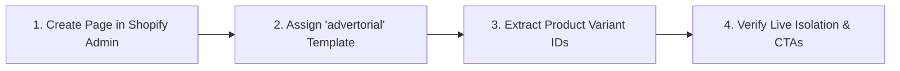

# Non-Technical Brand Operator Manual: Launching DTC Advertorials in 5 Minutes

This guide provides step-by-step instructions for non-technical brand founders, e-commerce managers, and media buyers to deploy new advertorial presell pages using the deployed engine.

---

## 🚀 Quick Launch Workflow (5 Minutes)

---

### Step 1: Create a New Page in Shopify Admin
1. Open your **Shopify Admin**.
2. Navigate to **Online Store** > **Pages**.
3. Click the green **Add page** button in the top right.
4. Set the **Title** (e.g., *"Dossier Spécial : Santé Artérielle & Coeur"*).
5. Leave the main text editor completely blank.

---

### Step 2: Assign the "advertorial" Theme Template
1. Look at the right-hand sidebar under **Online store**.
2. Locate the **Theme template** dropdown.
3. Select **`advertorial`** from the list.
4. Click **Save** in the top right.
5. Your page is now live at `https://your-store.com/pages/your-page-handle`!

> [!NOTE]
> By selecting the `advertorial` template, our engine automatically suppresses all headers, footers, store drawers, and Cash-On-Delivery buttons. You do **not** need to edit any code.

---

### Step 3: Link Your 3 Pricing Tier CTAs to Product Variants

To send traffic from the advertorial directly to the product page with pre-selected bundle options, format your CTA URLs with variant IDs:

1. Go to **Shopify Admin** > **Products** > Select your product (e.g. *Resilia*).
2. Scroll to the **Variants** section.
3. Click on a variant (e.g., *1 Flacon*, *3 Flacons*, or *6 Flacons*).
4. Look at your browser address bar: the number at the end of the URL is the **Variant ID** (e.g., `54617624969500`).
5. Map your CTA links as follows:

| Package Tier | Pricing Example | Target URL Structure |
| :--- | :--- | :--- |
| **Tier 1 (1 Flacon / 30 Days)** | Standard | `https://your-store.com/products/your-product-handle?variant=VARIANT_ID_1` |
| **Tier 2 (3 Flacons / 90 Days)** | Best Value | `https://your-store.com/products/your-product-handle?variant=VARIANT_ID_2` |
| **Tier 3 (6 Flacons / 180 Days)** | Maximum Savings | `https://your-store.com/products/your-product-handle?variant=VARIANT_ID_3` |

---

### Step 4: Disabling Storewide App Embeds (Optional Best Practice)

If you use third-party conversion apps like EasySell, COD Monster, or Releasit:
1. Go to **Online Store** > **Themes** > Click **Customize**.
2. On the far left sidebar, click the **App Embeds** icon (third icon from top).
3. Check if the app provides a toggle like *"Only show on product pages"*. If available, enable it.
4. If not, our built-in engine killswitch (`Object.freeze` + MutationObserver) will automatically eliminate the app on any page assigned the `advertorial` template.

---

### Step 5: Pre-Flight Ad QA Checklist (Before Spending Ad Budget)

Before launching Meta, TikTok, or Google Native ad campaigns:

- [ ] **Mobile Viewport Test**: Open the page on an actual iPhone/Android phone. Does the reading width fit comfortably with 16px margins?
- [ ] **Header / Navigation Check**: Ensure no store navigation logo, menu hamburger, or search bar is visible.
- [ ] **Footer Check**: Confirm that only the medical/regulatory disclaimer (Section 17) appears at the bottom, with no store newsletter or copyright footer.
- [ ] **Rogue App Check**: Verify that no floating or sticky COD button covers the advertorial copy.
- [ ] **CTA Click-Through Test**: Tap each of the 3 pricing tier buttons. Does each open the official product page with the correct bottle quantity pre-selected?
- [ ] **PDP Verification**: Visit the product page directly (`/products/...`). Confirm that the store header, regular navigation, and COD order form operate normally for buying customers.
