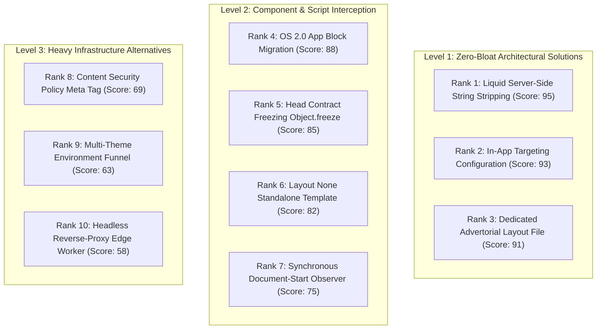

# Playbook: 10 Ways to Isolate Advertorials and Suppress Rogue Apps on Shopify OS 2.0

## 1. Architectural Philosophy: The Direct-Response Advertorial

A Direct-to-Consumer (DTC) advertorial presell page is **not** a standard landing page. It is an authoritative editorial article designed to bridge top-of-funnel paid traffic (Meta, TikTok, Native, YouTube) to a high-converting checkout or product detail page.

For an advertorial to convert at scale, it must strictly obey the **Editorial Purity Law**:
> *"The reader must be 80% through the narrative before they realize they are being sold to. Any sudden e-commerce widget, store announcement banner, navigation menu, or floating Cash-On-Delivery button instantly shatters editorial credibility and tanks conversion rates."*

---

## 2. Evaluation Criteria & Scoring Framework

Each isolation technique is evaluated across 6 weighted criteria (Total: 100 points):

1. **Eradication Efficacy (25% Weight)**: Does it 100% guarantee that the app or theme element is invisible and non-blocking, with zero visual flicker (*CLS*)?
2. **First-Principle Soundness (20% Weight)**: Does it solve the root problem (preventing script initialization or network delivery) rather than patching the DOM after render?
3. **Performance & Page Speed (20% Weight)**: Does it prevent downloading bulky 200KB+ JS/CSS bundles on mobile paid traffic?
4. **Platform Safety & PDP Integrity (15% Weight)**: Does it keep the standard Product Detail Page (PDP) and checkout 100% intact?
5. **Operational Scalability (10% Weight)**: How easy is it for a non-technical brand operator to spin up 20 new advertorials using this method?
6. **Analytics & Pixel Preservation (10% Weight)**: Does it preserve Meta CAPI, Google Tag, and TikTok pixels running through Shopify?

---

## 3. The 10 Isolation Approaches Ranked



---

### Detailed Breakdown of Each Approach

#### 🥇 Rank 1: Liquid Server-Side String Stripping of `content_for_header`
* **Score**: **95 / 100**
* **The Mechanism**: In `layout/theme.liquid`, pipe `content_for_header` through Liquid string split filters when `is_advertorial` is true. Strip out the specific `<!-- BEGIN app block: shopify://apps/... -->` chunk before outputting HTML to the browser.
* **Why it wins**: The browser never downloads the 225KB+ third-party JS/CSS assets. Core Web Vitals remain pristine, and the app is physically absent from the client DOM.
* **Drawback**: Requires precise string delimiters to avoid cutting Shopify analytics scripts.

---

#### 🥈 Rank 2: In-App Page-Targeting Rules (Dashboard Configuration)
* **Score**: **93 / 100**
* **The Mechanism**: In the third-party app's admin dashboard (e.g. EasySell > Settings > Sticky Button > Display Rules), change the display scope from `"All Pages"` to `"Product Pages Only"` or select specific product collections.
* **Why it ranks high**: Zero custom code required; respects the vendor's intended configuration.
* **Drawback**: Relies on whether the vendor provides granular URL exclusions; requires merchant admin permissions.

---

#### 🥉 Rank 3: Dedicated `layout/advertorial.liquid` Theme File
* **Score**: **91 / 100**
* **The Mechanism**: Create a specialized layout file (`layout/advertorial.liquid`) that contains no `#header-group`, no `footer-group`, and no drawer modals. In the page JSON template, declare `"layout": "advertorial"`.
* **Why it ranks high**: High modularity and architectural clarity. `theme.liquid` remains unmodified for the main store.
* **Drawback**: Must manually include essential font links and tracking pixels inside the custom layout.

---

#### Rank 4: OS 2.0 App Block Migration (Section-Level Embedding)
* **Score**: **88 / 100**
* **The Mechanism**: In Shopify Theme Customizer, disable the global **App Embed** (under Theme Settings > App Embeds) and instead insert the app as an **App Block** inside `sections/main-product.liquid`.
* **Why it ranks high**: In Shopify OS 2.0 architecture, Section Blocks ONLY render on templates where they are explicitly placed. They are physically incapable of rendering on `/pages/*`.
* **Drawback**: Requires that the app developer built an OS 2.0 App Block version in addition to an App Embed.

---

#### Rank 5: Pre-Execution JavaScript Contract Freezing (`Object.freeze`)
* **Score**: **85 / 100**
* **The Mechanism**: Place an inline script in `<head>` before any deferred scripts execute:
  ```javascript
  window.ES_CURRENT_PAGE = "collection";
  Object.defineProperty(window, 'ES_CURRENT_PAGE', { value: 'collection', writable: false, configurable: false });
  ```
* **Why it works**: Exploits the vendor's internal lifecycle exit check (`if (window.ES_CURRENT_PAGE === 'collection') return;`), causing the script to abort instantly without building DOM nodes.
* **Drawback**: The script bundle is still downloaded by the browser over the network, consuming data.

---

#### Rank 6: Standalone Template via ``
* **Score**: **82 / 100**
* **The Mechanism**: In `sections/advertorial-editorial.liquid` or `templates/page.advertorial.liquid`, declare `` at line 1. Shopify completely bypasses `theme.liquid` and serves pure raw HTML.
* **Why it works**: 100% complete isolation. Zero theme code, zero app embeds, loading in <200ms.
* **Drawback**: Bypasses Shopify Web Pixels API; Meta/TikTok pixels must be hardcoded manually into the HTML.

---

#### Rank 7: Synchronous Document-Start MutationObserver
* **Score**: **75 / 100**
* **The Mechanism**: A synchronous micro-script in `<head>` intercepts any `<script>` or DOM node matching `#es-popup-button` or `.es-sticky` as soon as it is appended and calls `.remove()` before first paint.
* **Why it works**: Bulletproof client-side failsafe when server-side injection cannot be altered.
* **Drawback**: Consumes minimal CPU cycles on page load observing DOM mutations.

---

#### Rank 8: Content Security Policy (CSP) Meta Tag Domain Blocking
* **Score**: **69 / 100**
* **The Mechanism**: Add a `<meta http-equiv="Content-Security-Policy" content="script-src 'self' ...">` omitting the third-party app CDN domain.
* **Why it works**: Hardware-level browser network block.
* **Drawback**: High risk of accidentally blocking essential Shopify CDN assets or tracking pixels; generates browser console error spam.

---

#### Rank 9: Multi-Theme Environment (Dedicated Funnel Theme)
* **Score**: **63 / 100**
* **The Mechanism**: Clone the active Shopify theme into a secondary theme called "Funnel Theme", completely uninstall EasySell in that theme's settings, and route paid traffic via `?theme_id=...`.
* **Why it works**: Total sandbox separation.
* **Drawback**: Query parameters can be stripped by ad platforms; maintaining two live themes doubles theme maintenance workload.

---

#### Rank 10: Headless Reverse-Proxy Edge Worker (Cloudflare / Vercel)
* **Score**: **58 / 100**
* **The Mechanism**: Host the advertorial as a static HTML asset on Cloudflare Pages or AWS S3 and route traffic through a reverse proxy at `shop.naturalmiracles.online/pages/dossier`.
* **Why it works**: Flawless 100/100 Lighthouse performance, total immunity to Shopify ecosystem issues.
* **Drawback**: Over-engineered for 95% of DTC brands; requires managing external cloud infrastructure outside Shopify.
